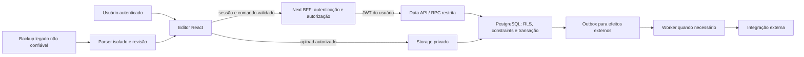

# 02 — Arquitetura-alvo

Status: proposta para o Cadastro de Peças. ERP completo exige descoberta própria. Nenhum serviço foi provisionado.

## Alternativas

| Critério | A: Next.js + Supabase + servidor no mesmo app | B: Next.js + API Node modular + Supabase | C: React/Vite estático + Supabase/RPC |
|---|---|---|---|
| Unidades principais | Web/BFF e Supabase | Web, API e Supabase | Web estática e Supabase |
| Base mensal de produção ilustrativa | US$45 com 1 assento Vercel e 1 projeto Supabase | US$65 com os mesmos + Railway Pro mínimo | US$25 + hosting estático, hipótese US$0–20 |
| Complexidade | Baixa/média | Média/alta: API, deploy, rede e contratos adicionais | Baixa no frontend; regras transacionais tendem a SQL |
| Segurança | BFF valida comandos; RLS conserva isolamento | API concentra comandos; RLS continua necessária | Data API exposta requer RLS, grants e RPC muito rigorosos |
| Latência/transferência | Uma etapa extra em comandos; escolher região próxima ao banco | Duas hospedagens, risco de travessia regional | Leitura direta reduz etapa; processamento pesado precisa servidor |
| Depuração | Um deploy de aplicação, trace até RPC | Trace distribuído entre web/API | Rastreamento cliente/RPC e erros SQL |
| Portabilidade | Domínio TS independente; trocar adaptadores | API Node mais independente, custo operacional maior | Front estático portátil; maior dependência de RPC/Auth |
| Equipes | Domínios isolados no mesmo monólito | Útil se API tem ciclo/clientes próprios | Boa para produto centrado no navegador |
| Crescimento | Worker quando necessário; não exige microsserviços | Worker/API persistente mais natural | Adequada ao cadastro; limites em integrações e jobs complexos |

Bases não incluem staging, logs, tráfego, compute adicional nem backups externos. Fontes e modelo de custo estão em [07](07-PERFORMANCE-CUSTOS.md).

## Decisão proposta: A, com possibilidade de rever para C

Adotar A para lançar cadastro multiusuário e acomodar importação segura, assinatura e futuras integrações em uma fronteira de servidor. A predominância de interação local não exige SSR para a planilha; usar componentes cliente e carregar parsers sob demanda. Next.js não é justificativa para renderizar todo o editor no servidor.

C seria preferível se o roadmap se limitar a cadastro/exportação, sem integrações com segredos e sem processamento assíncrono relevante. B fica adiada até haver clientes de API independentes, tarefas longas medidas ou equipe com ciclo de publicação separado. Dez mil tenants não justificam B por si só.

Ferramentas propostas: TypeScript strict, React, Next.js com versão estável suportada fixada no início da implementação; validação Zod ou equivalente com schemas explícitos; TanStack Query para estado remoto no cliente; Vitest para domínio, Playwright para fluxos, testes SQL/pgTAP para políticas. Nenhuma versão nova foi instalada ou validada nesta auditoria. Fixar versões/lockfile e conferir compatibilidade antes do primeiro PR.

## Limites de confiança

Browser e arquivos são não confiáveis. `tenant_id` recebido é seletor, nunca prova de acesso. BFF verifica sessão no servidor, membership ativo e permissão; PostgreSQL repete isolamento e invariantes. Não usar `service_role` para CRUD comum: transmite JWT do usuário às operações no banco. Evitar cache de cliente Supabase autenticado compartilhado entre requisições.

Leituras passam inicialmente pelo BFF para manter contratos e observabilidade simples. Só introduzir acesso direto se métricas justificarem e os testes provarem mesma autorização. Upload direto pode usar autorização curta, com bucket privado, metadados conferidos e finalização pelo BFF.

Identidade, catálogo, importação, exportação, mídia e arquivo são módulos do mesmo processo. Comandos que alteram múltiplas tabelas são uma RPC transacional ou uma transação SQL com papel restrito. Regras puras podem gerar preview no cliente; servidor recalcula e valida dados canônicos antes de confirmar. Não confiar em preço total calculado pelo browser.

## Integrações e efeitos externos

Não incluir Edge Functions por padrão: adicionariam outro runtime sem necessidade demonstrada. Usar quando webhook/execução regional tiver justificativa e limites medidos. Upload, envio de email ou publicação de imagem não participam de transação SQL; registrar outbox no commit, processar com idempotência e reconciliar falhas.

Imagens privadas e links públicos para Bling são necessidades distintas. Não tornar todo o bucket público para satisfazer exportação: publicar apenas a versão explicitamente autorizada, com registro de consentimento operacional, escopo e revogação. Links assinados curtos podem expirar antes de uma importação externa; validar o contrato do destino.

PostgreSQL é fonte de verdade do SaaS. No lançamento, offline é consulta de cache e rascunho identificado por tenant, não replicação automática irrestrita. Modo local legado permanece disponível durante transição. Sincronização offline completa requer ADR próprio para conflitos e revogação.
