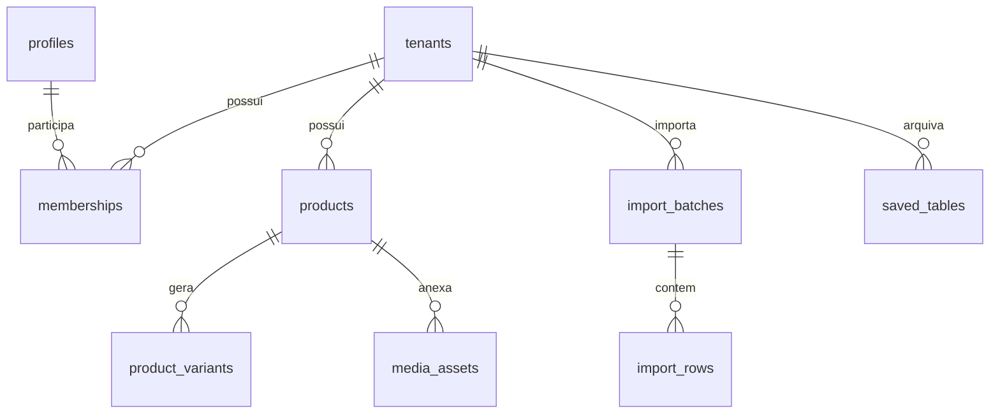

# 04 — Banco, integridade e transações

## Situação atual

CONFIRMADO: JSON em localStorage, três stores IndexedDB e três caminhos de documento remoto opcionais; não há schema PostgreSQL local. Inventário SQL, planos de execução, índices, grants, transações do provedor, pool e backups remotos: NÃO VERIFICADOS. Não foram executados SQL ou migrations.

## Modelo inicial proposto

UUIDs gerados no servidor/banco para entidades SaaS. `legacy_id` é string preservada em mapa de migração, nunca reutilizada automaticamente como identidade global. Valores monetários enviados como decimal textual, armazenados em `numeric`; não transmitir em float como fonte canônica.

| Tabela | Chaves / campos essenciais | Integridade e exclusão |
|---|---|---|
| tenants | id UUID PK; name; status active/suspended/deleting; plan_id | check status; exclusão por workflow, não cascade instantâneo |
| profiles | user_id PK/FK auth.users; display_name | sem papel global editável pelo usuário |
| memberships | id PK; tenant_id; user_id; status | unique(tenant_id,user_id), unique(tenant_id,id); FKs; revogação mantém histórico |
| roles | id; tenant_id; name | unique(tenant_id,id), unique(tenant_id,name); nomes não são autoridade |
| permissions | code PK | catálogo global controlado por migrations |
| role_permissions | tenant_id,role_id,permission_code | PK tripla; FK (tenant_id,role_id); grant administrativo restrito |
| membership_roles | tenant_id,membership_id,role_id | PK tripla e FKs compostas para ambos os vínculos |
| invitations | id,tenant_id,email_normalized,token_hash,expires_at,accepted_at | token único, uso único transacional, aceite requer identidade compatível |
| categories / suppliers / finishers | id,tenant_id,name,archived_at | unique(tenant_id,id); preservar nomes/IDs do legado; arquivar referenciados |
| catalog_settings | tenant_id PK,version,config_schema_version,payload | JSON validado para modelos/grades ainda flexíveis; não esconder FKs essenciais no JSON |
| products | id,tenant_id,category_id,supplier_id,kind,revision,description | unique(tenant_id,id), checks kind/revision; FKs compostas; soft archive |
| product_variants | id,tenant_id,product_id,reference,quantity,cost,price | FK (tenant_id,product_id); unique(tenant_id,reference); quantity >= 0; custo/preço >= 0 |
| product_components | tenant_id,parent_id,component_id,quantity | FKs compostas; quantity > 0; regra impede ciclos de conjuntos |
| reference_counters | tenant_id,prefix,next_value,width | PK (tenant_id,prefix); next_value > 0; incremento transacional |
| import_batches | id,tenant_id,source_hash,status,revision,idempotency_key | unique(tenant_id,idempotency_key); status por máquina de estados |
| import_rows | id,tenant_id,batch_id,row_no,payload,validation_errors | FK composta; unique(tenant_id,batch_id,row_no) |
| imported_documents | id,tenant_id,source_key,source_hash,batch_id | unique(tenant_id,source_key) para NF válida; repetição excepcional auditada |
| saved_tables | id,tenant_id,name,created_by,snapshot_version,payload | snapshots imutáveis; FK autoria; blobs não entram em JSON |
| media_assets | id,tenant_id,product_id,object_path,hash,status | FK composta; unique(bucket,object_path); pending/ready/deleted |
| audit_events | id,tenant_id,actor_id,action,entity_id,request_id,created_at | append-only; sem payload sensível integral |
| idempotency_records | tenant_id,operation,key,request_hash,result,status | PK composta; mesma chave + corpo diferente deve falhar |
| outbox | id,tenant_id,event_type,payload,status,attempts,next_attempt_at | inserida no commit; retry limitado, deduplicação no consumidor |
| migration_maps | tenant_id,source_snapshot,entity_type,legacy_id,new_id | chave única composta; permite retomada e reconciliação |

Escalas propostas: quantidade/peso `numeric(18,4)`, custos intermediários `numeric(18,6)`, totais em moeda `numeric(18,2)` e moeda explícita (inicial BRL). Validar limites reais; migração não deve arredondar silenciosamente valores antigos. Fórmula do banho, percentual/markup e custo de conjunto precisam de fixture e versão de cálculo. Documentar arredondamento por linha e total; distribuir resíduo de centavos por regra estável.

## Integridade entre empresas

FK simples de `product_id` não impede vínculo com produto de outra empresa. Toda relação empresarial deve usar `(tenant_id,id)` no destino e `(tenant_id,parent_id)` na origem. `tenant_id NOT NULL`; coluna imutável para usuário comum, com privilégio de atualização restrito ou trigger. `WITH CHECK` sozinho não bloqueia troca entre duas empresas das quais o mesmo usuário é membro.

Cadastros referenciados usam RESTRICT/arquivamento. Cascade só em dependentes sem valor autônomo, após revisar retenção e histórico. Nenhuma exclusão de tenant por chamada genérica do frontend. Suspensão é verificada em toda autorização; não apagar lançamentos para suspender assinatura.

## Operações atômicas

| Operação | Unidade transacional proposta | Concorrência / falha |
|---|---|---|
| Confirmar romaneio/NF | validar lote e versão; reservar referências; inserir produtos/variantes; marcar linhas; audit/outbox | chave de idempotência; lock lote e contadores em ordem fixa; rollback completo no erro |
| Editar produto | update onde revision=expected; incrementar revisão; audit | zero linhas significa conflito, retornar 409 e preservar rascunho |
| Salvar tabela e começar outra | snapshot + referências confirmadas + estado do trabalho | confirmar commit antes de limpar UI |
| Importar backup | staging por lote; validação; promoção controlada; manifesto | retomada por mapa/hashes; não misturar tenants; fonte nunca apagada |
| Upload | criar asset pending; upload; validar hash/tamanho; ready | objeto órfão recolhido após TTL; falha de upload não publica asset |
| Convite/assinatura | verificação, membership/entitlement, audit | token/evento único; repetição retorna resultado anterior |

Usar Read Committed com constraints, locks e revisão quando suficiente. Serializável apenas para invariantes que não podem ser garantidas dessa forma, com retries limitados e idempotentes. Definir ordem de locks para lotes e contadores; não manter transação aberta durante PDF, upload ou chamada externa.

## Financeiro futuro — não implementado

Não migrar preço/custo como se fossem saldo de caixa. Se financeiro entrar no produto, criar razão de lançamentos imutáveis e conciliação; pagamento/recebimento + alocação + movimento + auditoria em uma transação, idempotência única por tenant/operação e limite de valor pago protegido por lock. Estorno é lançamento inverso referenciado; parcial não pode superar saldo reversível. Webhook duplicado não duplica baixa. Reconciliar total alocado, saldo e extrato; falha depois do commit e antes da resposta deve retornar o mesmo resultado em retry.

Orçamento→pedido, compra→estoque e conclusão de produção exigem contratos de estado e eventos, mas não há código correspondente para auditar aqui. São novos domínios, fora da estimativa inicial.

## Índices e migrations

PKs/uniques acima sustentam integridade. Índices de consulta são candidatos, não recomendação de criação imediata: `products(tenant_id,updated_at,id)` para lista por cursor; `memberships(user_id,tenant_id)` para autorização; `import_rows(tenant_id,batch_id,row_no)` para revisão. Evitar índice redundante com prefixo já coberto por unique. FKs de filhos grandes precisam de avaliação de join/delete; custo de escrita deve ser medido.

Coletar consultas reais, cardinalidade por tenant, `EXPLAIN (ANALYZE, BUFFERS)` em staging sintético, tempo de RLS e concorrência. ANALYZE executa a consulta; não executar escrita de produção como diagnóstico. Sequencial em tabela pequena não é defeito. Observar bloqueios, transações longas, I/O, índices não usados e autovacuum antes de particionar.

Migrations versionadas e imutáveis após merge. Expandir schema → publicar aplicação compatível → backfill retomável → validar → contrair em release posterior. Reservar nomes/ordem com owner de banco; testar banco vazio e upgrade do snapshot anterior. Falha de migration: parar rollout, forward-fix ou restaurar em ambiente separado; não usar down destrutivo como rollback automático.
